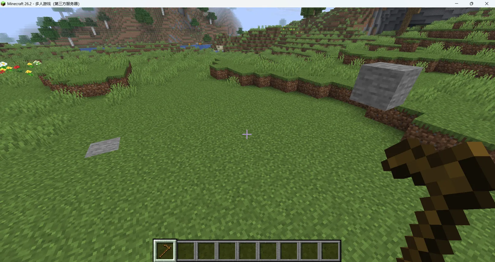
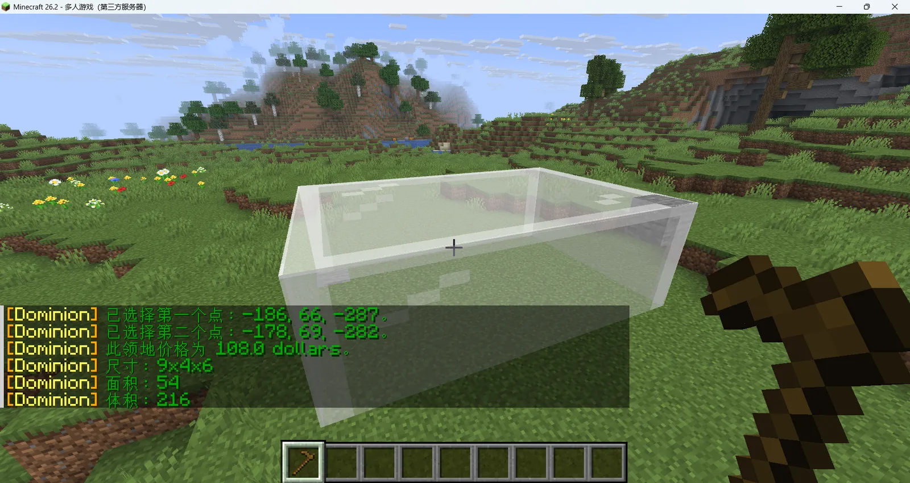
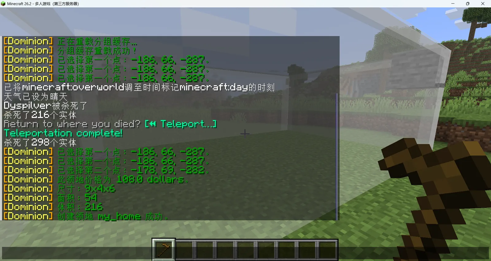

# 🏠领地系统
---
## 创建领地
### 1.圈画领地范围
手持木锄，对着你索要圈画的领地的对角的2个方块分别左右键
例如图中的圆石所示
> 注意：两个点必须在同一个世界

分别左右键之后会显示出领地的范围，应该是这样的

> 选区是一个三维长方体，不是只覆盖地面的一块二维矩形。两个点的 X、Y、Z 会分别取最小值和最大值
### 2.输入创建领地指令
圈画出领地范围之后，输入 `/dom create [name]`
> 这里的[name]指的是领地的名字，支持中文

::: info
默认情况下，你的最小领地不小于4x4x4，最大不超过128x64x128
:::
::: tip
创建领地需要花费游戏币，价格为0.5游戏币/方块，如果你想了解新手如何快速攒钱，你可以看这[]
:::
## 领地常用指令
> 注:以下的所有dominion都可以简化为dom
### 领地的父指令为/dom  
> 你可以输入他来了解更多领地的主界面，以下是常用指令

`/dominion info` 查看当前位置

`/dominion resize [name] [expand|contract] [size] [north|east|south|west|up|down]` 扩大或缩小领地（指定领地操作）
> 当你处于领地内时，可以简化为
> `/dominion expand <size> [direction]`
> `/dominion contract <size> [direction]`

`/dominion tp [name]` 传送至领地

`/dominion set_tp [name]` 设置领地传送点(站在领地内执行)

`/dominion info` 查看领地信息(站在领地内执行)
> 领地的大部分操作都可以在/dom打开的主页面内进行，如果你想详细了解领地，你可以阅读https://mc.lunadeer.cn/docs/plugins/dominion/player

