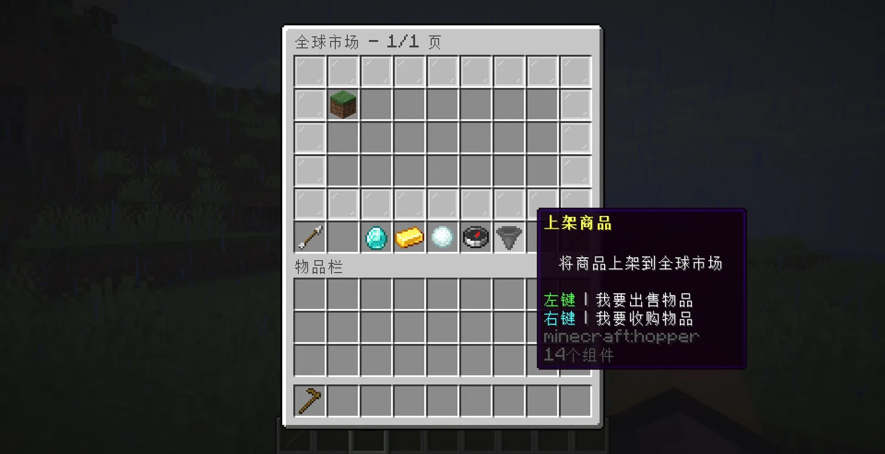
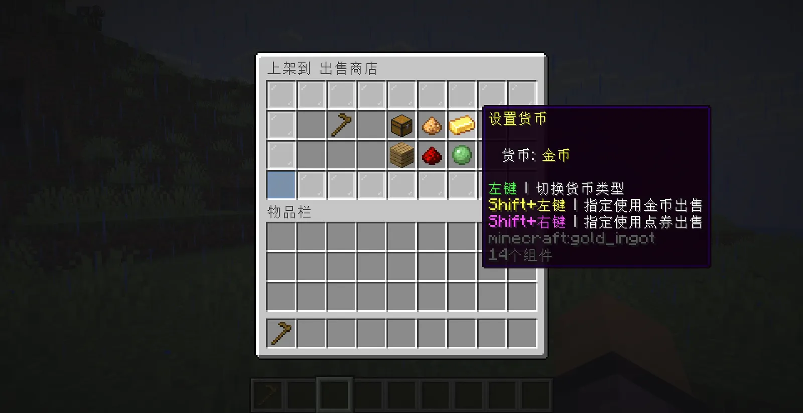

# 🪙全球市场
---
全球市场是一个由玩家主导的市场，每个玩家都可以将自己所需要买卖的物品放到全球市场上，可以被全服玩家看见。
## 1.上架商品
/pm open  打开全球市场页面
点击漏斗

商品上架设置

> 此处的配置清晰，不过多赘述
## 2.关于全球市场你需要知道的几点
- 上架的商品默认会存在5天
- 默认情况下，每个玩家可以上架出售10个商品，收购15个商品
- 上架全球市场会收取5%的手续费(基于设定价格，且与交易货币类型相同)